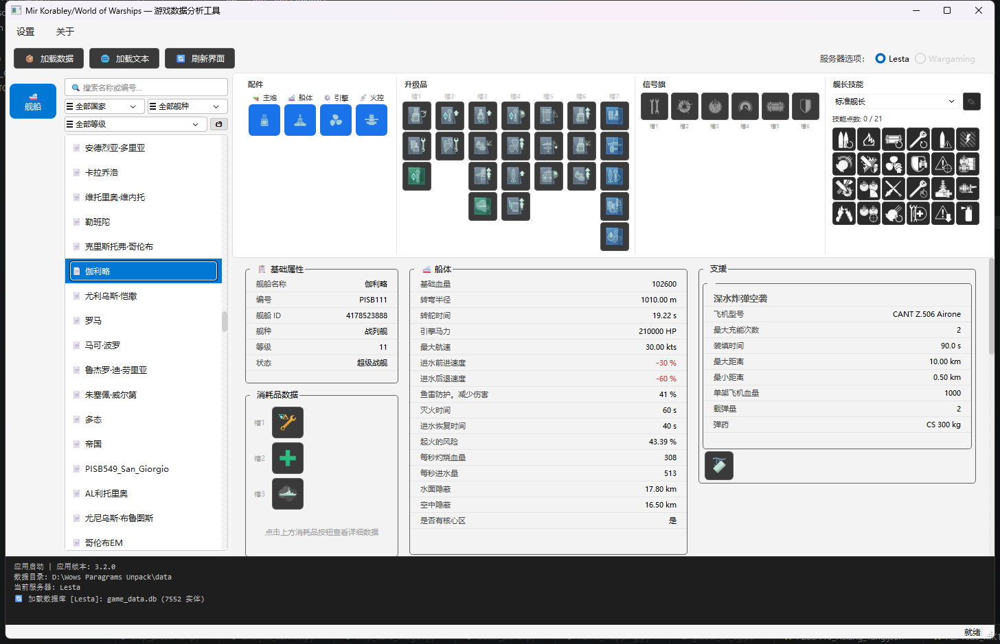

# Wows Paragrams Unpack

> 战舰世界 / Korabli 游戏数据自动化提取与分析工具

## 当前版本

[](https://github.com/walksQAQ/Wows_Paragrams_Unpack/releases)

[](https://github.com/walksQAQ/Wows_Paragrams_Unpack/releases/latest)

---

## 📖 简介

本工具用于从 **《战舰世界》（World of Warships / Mir Korablei）** 中提取、解析并可视化游戏数据。纯 Python 实现，支持 **Wargaming（WG）** 与 **Lesta（莱斯塔）** 双服务器。

- 完整数据链：舰船、模块、火炮、炮弹、飞机、消耗品、升级品、舰长等
- 资源提取：GameParams、assets.bin、PKG/IDX、纹理（bc7prep/DDS）、模型与特效等二进制格式解析
- 可视化：3D 舰船模型与装甲查看、穿深与散布计算、涂装与特效展示

---

## ✨ 功能特性

| 功能 | 说明 |
|------|------|
| 🔓 **数据提取** | 自动从游戏目录提取最新 GameParams / assets.bin，并在本地保存 |
| 🖥️ **图形界面** | PySide6 构建，分类导航 + 筛选 + 详情查看 |
| 🌐 **本地化** | 自动下载语言文件，显示中文名称 |
| 📦 **单文件打包** | 基于 Nuitka 编译为独立 exe，无需 Python 环境 |
| ⚔️ **3D 可视化** | `.geometry` 模型解析 + 装甲厚度着色渲染（PyOpenGL） |
| 🎯 **穿深 / 散布** | 基于游戏公式的穿深、纵向 / 横向散布计算 |
| 🧊 **模型导出** | 导出 GLB / glTF 2.0（含装甲模型、PBR 通道贴图、挂点层级、顶点权重） |
| 🧾 **明文转码**（实验性） | assets.bin 的 `.mfm` / `.visual` / `.model` / `.skel_ext` 转 Mod SDK 明文格式 |


### 使用流程

```
1. ⚙ 设置 → 高级设置，配置游戏目录路径，选择服务器（Lesta / Wargaming）
2. 📦 点击"加载数据" — 自动提取并解析数据
3. 🌐 点击"加载文本" — 下载中文语言文件（可选）
4. 左侧选择分类 → 中间筛选文件 → 右侧查看详情
```

#### 导出的 GLB 在 Blender 里怎么用

- **默认（勾选“导出骨骼顶点组”）**：层级/命名与 BigWorld 插件（`.primitives + .visual`）
  一致，`Scene Root → 部件 → visual 节点 → <Shape>`；蒙皮网格写标准 glTF skin，
  Blender 里直接得到顶点组与 Armature。骨骼显示球是 Blender 导入选项 "Bone Shape"
  造成的，导入时取消勾选即可隐藏。
- **取消勾选“导出骨骼顶点组”**（`GlbRenderOptions(export_skins=False)`）：**不含骨架**，
  所以没有骨骼球。顶点权重仍完整保存在网格属性里（`_JOINTS_0`/`_WEIGHTS_0` +
  `bone_palette`），需要顶点组时在 Blender 运行一次
  `tools/blender_wows_vertex_groups.py`（Scripting 工作区 → Run Script，或
  `blender --background --python tools/blender_wows_vertex_groups.py -- 模型.glb`），
  它会按上述属性还原顶点组，**不会创建骨架**。
- **顶点组与游戏内一致**：骨骼索引 = 渲染集调色板 slot × 3（同 BigWorld 插件的
  `index//3`），调色板按 `.visual` 原始顺序保留；同一材质下不同调色板的 shape 会
  拆成独立网格，避免权重被翻译到别人的骨骼上。


---
<br>

## 📸 程序主界面截图




## 🧪 实验性功能：assets.bin 明文转码

assets.bin 浏览器里的「明文格式」/「导出明文」会把 `.mfm` / `.visual` / `.model` /
`.skel_ext` 转成 Mod SDK 明文样式。**该功能为实验性，可能存在部分数据有误。**

原因是 assets.bin 的记录布局与 Mod SDK 明文并非一一对应，已知差异包括：

- `<parentMfm>` 继承链：明文里有，assets.bin 二进制里没有（因此不会输出）；
- `<collisionFlags>`：SDK 导出器**一律写 0**（Lesta 26.10 共 13,068 处、WG 15.9 全部
  29,184 个文件都是 0），而 assets.bin 里该字段的真实值大量为 1/2/3
  （碰撞面标记：`0x01` = 相机可穿透、`0x02` = 镂空/alphaTest 面）。
  本工具写**真实值**，`<materialKind>` 仅非 0 时写出（仅 mesh_decal 地表类型）。
  两者语义详见 [docs/prototype-formats.md](./docs/prototype-formats.md)；
- 数组属性按「材质 ID 稀疏」写出，全零项省略，与 SDK 的实际写法可能存在出入；
- `.visual` 的节点旋转限制、部分 renderSet 标志在二进制中缺失。

请以**游戏内实际表现**为准；转码结果用于对照/排查，不建议直接当作官方 SDK 导出物使用。


## ⚠️ 免责声明

本工具仅用于学习和研究目的，所有游戏数据均由用户自行从其游戏客户端提取，本工具仅随附部分取自客户端的图片，不附带任何游戏数据或其他官方素材。

- 游戏相关一切内容版权归 **Wargaming.net** 或 **Lesta Studio** 所有；
- 例外：部分图片（如舰船/装备图标等）取自游戏客户端，随本工具打包分发，仅用于程序内数据辨识与展示，版权归原公司所有；
- 请勿将本工具用于商业用途，或再传播从游戏客户端提取的受版权保护内容。

---

## 📄 许可证

本仓库采用**分离授权**结构，按代码归属分别适用不同许可证：

- **Apache License 2.0**：除下述 GPLv3 文件外，本仓库全部原创代码与文档按 Apache-2.0 授权（含专利授权条款）。详见 [LICENSE.Apache-2.0](./LICENSE.Apache-2.0)。
- **GPLv3**：`data_extractor/kraken.py` 基于 [kraken-decompressor](https://github.com/domdfcoding/kraken-decompressor)（GPLv3）移植，单独按 GNU GPL v3.0（或更高版本）授权，不适用 Apache-2.0。详见 [LICENSE.GPLv3](./LICENSE.GPLv3) 与该文件头部的许可证声明。

> ⚠️ **组合分发提示**：`kraken.py` 被本程序其余部分导入并构成同一组合程序。当你**分发**包含该文件的组合程序（如打包后的 exe）时，整体分发行为须遵守 GPLv3 的相应义务（提供对应源代码等）。Apache-2.0 与 GPLv3 兼容，可共存于同一程序。详见 [LICENSE](./LICENSE)。

## 👤 作者

- **walksQAQ** — 开发维护
- 仓库: [https://github.com/walksQAQ/Wows_Paragrams_Unpack]
- 下载编译好的程序请到 **Releases** 页面查找。


## ✨ 特别鸣谢

感谢 **DeepSeek**、**GitHub Copilot**、**Gemini** 等 AI 工具在本项目开发过程中的协助，大幅降低了代码编写、逆向分析与调试的工作量。


---
<br>

## 📚 引用与技术来源

本工具为纯 Python 实现，绝大多数数据格式分析参考和借助了以下开源项目与官方提供的部分文件，并结合 Ghidra 对游戏客户端的逆向验证。完整格式文档见仓库内 `docs/` 目录。

### 本项目参考

| 类别 | 项目 / 来源 | 用途 |
|------|------------|------|
| 格式解析 | [landaire/wows-toolkit](https://github.com/landaire/wows-toolkit) | IDX / PKG / `.geometry` / assets.bin / 材质 / 装甲 / camo 等格式与功能参考 |
| 格式解析 | [EdibleBug/WoWS-GameParams](https://github.com/EdibleBug/WoWS-GameParams) | `GameParams.data` 解析参考 |
| 解压算法 | [domdfcoding/kraken-decompressor](https://github.com/domdfcoding/kraken-decompressor)（C++，GPLv3） | Oodle Kraken 解压参考（对应移植文件 `data_extractor/kraken.py`） |
| 解压算法 | [powzix/kraken](https://github.com/powzix/kraken) | Kraken `DecodeBytes` / Huffman 熵解码参考 |
| 解压算法 | [detly/oozextract](https://github.com/detly/oozextract) | Oodle 解压（TANS / RLE / Huffman）参考 |
| 解压算法 | [WorkingRobot/OodleUE](https://github.com/WorkingRobot/OodleUE) | Oodle 引擎集成（2.9.15）、bc7prep 纹理格式参考 |
| 本地化 | [LocalizedKorabli/Korabli-LESTA-L10N](https://gitlab.com/localizedkorabli/korabli-lesta-l10n) | 本地化文本来源仓库 |
| 界面 / 计算 | [浩舰 iwarship](https://iwarship.net/wowsdb/dap) | 部分数据界面、散布穿深计算器参考 |
| 界面 / 计算 | [MKtool](https://mktool.info) | 舰船详情 / 穿深计算参考 |
| 3D 可视化 | [PyOpenGL](https://pypi.org/project/PyOpenGL/) / [pygltflib](https://github.com/teknotus/pygltflib) / [meshoptimizer](https://pypi.org/project/meshoptimizer/) | `.geometry` 解析与装甲展示渲染（PySide6 `QOpenGLWidget` + OpenGL）、GLB / glTF 2.0 导出、网格优化 |

<br>